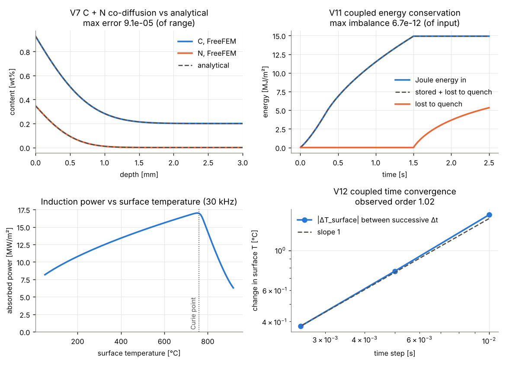
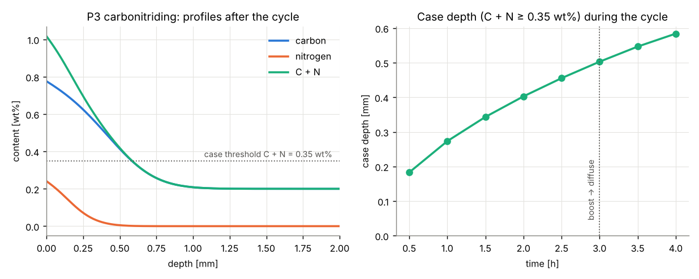
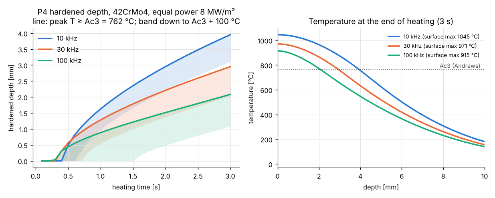
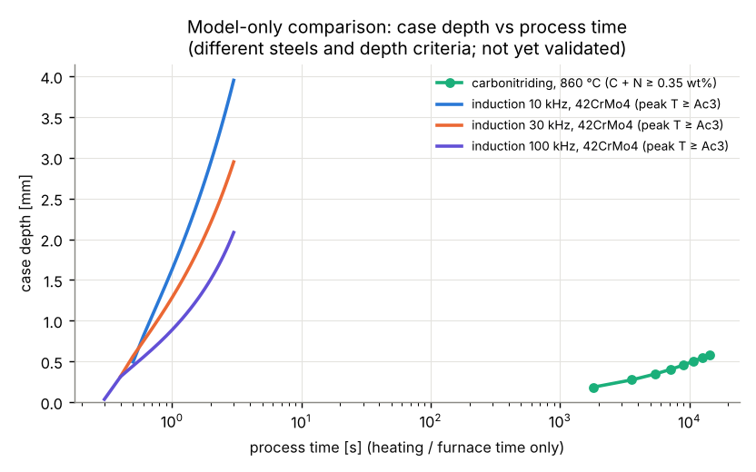
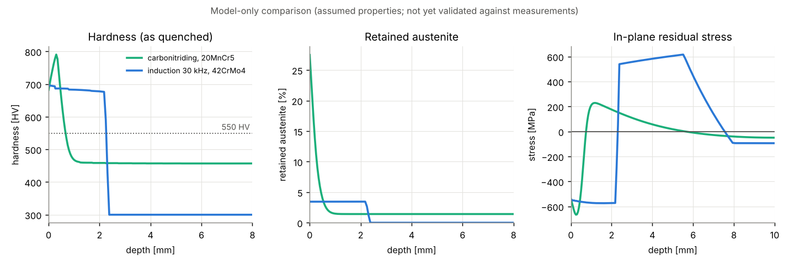
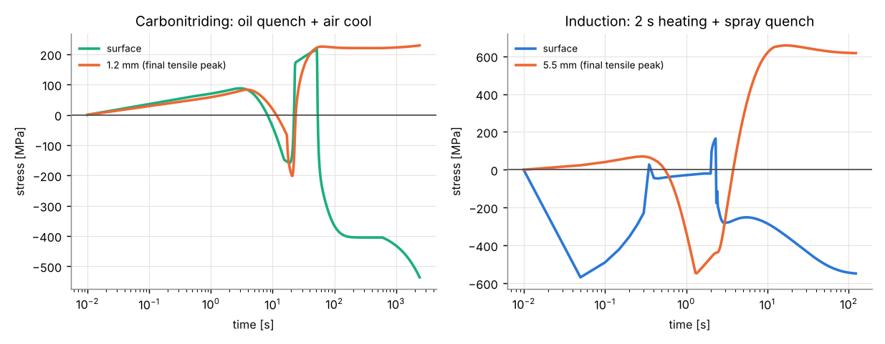

# Verification & validation report

Generated by `scripts/run_all.py`. Numbers below are copied from `summary.json`.

## Verification against analytical solutions

| Case | Error | Tolerance | Result |
|---|---|---|---|
| V1 diffusion, Dirichlet (erfc) | 6.56e-05 | 0.001 | PASS |
| V2 diffusion, Robin (mass transfer) | 9.07e-05 | 0.001 | PASS |
| V3 eddy current (below curie) | 2.08e-06 | 0.001 | PASS |
| V3 eddy current (above curie) | 2.08e-06 | 0.001 | PASS |
| V4 quench, convective surface | 1.83e-04 | 0.001 | PASS |
| V5 convergence (V2, dt ~ h^2) | observed order 1.98 | 1.8 | PASS |

## Validation against published data

### P1: case depth vs the Harris (1943) correlation

Harris' correlation was fitted to measured carburized case depths. Model: Tibbetts (1980)
carbon diffusivity D(C,T), surface mass transfer β (assumed; see sensitivity), 927 °C,
carbon potential 1.0 wt%, core 0.2 wt%. Total case depth taken at c₀ + 0.05 wt%.

| β [m/s] | t [h] | surface C [wt%] | total case [mm] | depth at 0.4 %C [mm] | Harris [mm] | diff |
|---|---|---|---|---|---|---|
| 1e-07 | 2 | 0.797 | 0.722 | 0.433 | 0.899 | -19.6 % |
| 1e-07 | 4 | 0.847 | 1.069 | 0.669 | 1.271 | -15.9 % |
| 1e-07 | 8 | 0.888 | 1.569 | 1.012 | 1.797 | -12.7 % |
| 1e-07 | 16 | 0.918 | 2.284 | 1.505 | 2.542 | -10.1 % |
| 2e-07 | 2 | 0.887 | 0.785 | 0.505 | 0.899 | -12.7 % |
| 2e-07 | 4 | 0.918 | 1.142 | 0.752 | 1.271 | -10.1 % |
| 2e-07 | 8 | 0.941 | 1.653 | 1.105 | 1.797 | -8.0 % |
| 2e-07 | 16 | 0.958 | 2.378 | 1.607 | 2.542 | -6.4 % |
| 5e-07 | 2 | 0.953 | 0.837 | 0.563 | 0.899 | -6.9 % |
| 5e-07 | 4 | 0.966 | 1.200 | 0.815 | 1.271 | -5.6 % |
| 5e-07 | 8 | 0.976 | 1.715 | 1.172 | 1.797 | -4.6 % |
| 5e-07 | 16 | 0.983 | 2.445 | 1.678 | 2.542 | -3.8 % |

Time exponent of case depth (β = 2e-7): 0.533 (ideal diffusion: 0.5). Acceptance: within ±20 % at β = 2e-7 → **PASS**.

### P2: digitized published profiles

No datasets in `data/published/` yet. See `data/published/README.md` for the format and
candidate open-access sources.

## Milestone 2: carbonitriding and coupled induction heating

### Verification

| Case | Error | Tolerance | Result |
|---|---|---|---|
| V6 stage split invariance | 0.00e+00 | 1e-10 | PASS |
| V7 C + N co-diffusion vs analytical | 9.07e-05 | 0.001 | PASS |
| V8 C + N mass conservation (boost/diffuse) | 0.00e+00 | 1e-08 | PASS |
| V9 cross-code consistency | 0.00e+00 | 1e-10 | PASS |
| V10 induction surface power vs analytical | 2.72e-04 | 0.001 | PASS |
| V11 coupled energy conservation | 6.70e-12 | 1e-08 | PASS |
| V12 coupled time convergence | observed order 1.02 | 0.9 | PASS |

### Process demonstrations (model only, not yet validated against measurements)

Assumed inputs (to be replaced by measured / OpenFOAM / OpenCalphad data): carbon and nitrogen
potentials, β_N = 1e-7 m/s, induction properties μr = 20 below Curie (760 °C), σ(T) linear in
resistivity, k = 30 W/m K, ρcp = 4 MJ/m³K, spray-quench h = 2e4 W/m²K. Nitrogen diffusivity:
Grieveson & Turkdogan (1964); C-N thermodynamic interaction not yet included.

**Carbonitriding** (3 h at 860 °C + 1 h at 860 °C): surface C = 0.78 wt%, N = 0.24 wt%, case depth (C + N ≥ 0.35 wt%) = 0.58 mm.

**Induction hardening** (42CrMo4, Andrews Ac1 = 740 °C, Ac3 = 762 °C, equal cold surface power 8 MW/m², 3 s heating):

| Frequency | Hardened depth, peak T ≥ Ac3 [mm] | ≥ Ac3 + 100 °C [mm] | Peak surface T [°C] | Joule energy [MJ/m²] |
|---|---|---|---|---|
| 10kHz | 3.95 | 3.11 | 1045 | 26.2 |
| 30kHz | 2.95 | 2.03 | 971 | 22.7 |
| 100kHz | 2.08 | 1.09 | 915 | 20.1 |

## Milestone 3: phases, hardness, retained austenite, residual stress

Chain: diffusion (C + N) or induction heating → quench heat transfer → austenitization (lever rule
Ac1–Ac3, Andrews) → martensite (Koistinen–Marburger, Ms by van Bohemen 2012 with C + N) → hardness
(Maynier 1978 for martensite, rule of mixtures) → equi-biaxial elasto-plastic layer model with
phase-specific volumes (Moyer & Ansell 1975) and TRIP. Not modelled yet: diffusional
transformations on cooling (needs CCT data), tempering, C–N interaction.

### Verification

| Case | Error | Tolerance | Result |
|---|---|---|---|
| V13 thermo-elastic plate vs analytical | 6.25e-06 | 0.0001 | PASS |
| V14 uniform history gives zero stress | 0.00e+00 | 1e-10 | PASS |
| V15 equilibrium (all chains) | 1.35e-14 | 1e-10 | PASS |
| V16 yield consistency (all chains) | 0.00e+00 | 1e-06 | PASS |
| V17 mesh sensitivity of process outputs | 1.11e-03 | 0.02 | PASS |

### Process outputs (model only, assumed properties)

| Output | Carbonitriding (20MnCr5, 4 h 860 °C, oil) | Induction (42CrMo4, 30 kHz 2 s, spray) |
|---|---|---|
| Surface hardness [HV] | 682 | 696 |
| Core hardness [HV] | 457 | 300 |
| CHD at 550 HV [mm] | 0.67 | 2.26 |
| Depth at 0.8 × surface HV [mm] | 0.68 | 2.26 |
| Surface retained austenite [%] | 27.5 | 3.4 |
| Surface residual stress [MPa] | -536 | -548 |
| Most compressive [MPa] | -666 | -574 |
| Peak tensile [MPa] | 229 | 616 |
| Depth of tensile peak [mm] | 1.20 | 5.51 |

### Sensitivity to assumed inputs (one at a time)

| Process | Parameter | Value | Surface σ [MPa] | Peak tensile [MPa] | Surface HV | Surface RA [%] | CHD-550 [mm] |
|---|---|---|---|---|---|---|---|
| carbonitriding | K_trip [1/MPa] | 0 | -1613 | 245 | 682 | 27.5 | 0.67 |
| carbonitriding | K_trip [1/MPa] | 5e-05 | -536 | 229 | 682 | 27.5 | 0.67 |
| carbonitriding | K_trip [1/MPa] | 0.0001 | -309 | 139 | 682 | 27.5 | 0.67 |
| carbonitriding | oil HTC [W/m2K] | 1000 | -534 | 143 | 674 | 27.5 | 0.65 |
| carbonitriding | oil HTC [W/m2K] | 2000 | -536 | 229 | 682 | 27.5 | 0.67 |
| carbonitriding | oil HTC [W/m2K] | 4000 | -542 | 312 | 695 | 27.5 | 0.69 |
| induction | K_trip [1/MPa] | 0 | -1321 | 621 | 696 | 3.4 | 2.26 |
| induction | K_trip [1/MPa] | 5e-05 | -548 | 616 | 696 | 3.4 | 2.26 |
| induction | K_trip [1/MPa] | 0.0001 | -418 | 615 | 696 | 3.4 | 2.26 |
| induction | Ac shift [C] | 0 | -548 | 616 | 696 | 3.4 | 2.26 |
| induction | Ac shift [C] | 50 | -567 | 614 | 696 | 3.4 | 1.89 |
| induction | Ac shift [C] | 100 | -589 | 613 | 696 | 3.4 | 1.45 |
| induction | spray HTC [W/m2K] | 10000 | -582 | 615 | 684 | 3.5 | 2.26 |
| induction | spray HTC [W/m2K] | 20000 | -548 | 616 | 696 | 3.4 | 2.26 |
| induction | spray HTC [W/m2K] | 40000 | -491 | 617 | 700 | 3.4 | 2.26 |

## PINN (hybrid layer)

Forward: max error vs analytical 0.27 % of range (tolerance 3 %) → **PASS**. Training 269 s on CPU (20000 steps); inference 2.52 ms for a 301-point profile.

| t [h] | PINN vs analytical | FreeFEM vs analytical |
|---|---|---|
| 0.5 | 0.16 % | 0.065 % |
| 1 | 0.27 % | 0.034 % |
| 2 | 0.16 % | 0.018 % |
| 4 | 0.24 % | 0.009 % |

Inverse (synthetic: FreeFEM + 1 % Gaussian noise, 3 times x 12 depths): starting from D = 7.50e-12, β = 6.00e-07, identified D = 1.546e-11 m²/s (true 1.50e-11, error 3.0 %), β = 1.873e-07 m/s (true 2.00e-07, error 6.4 %). Tolerance 15 % → **PASS**.

