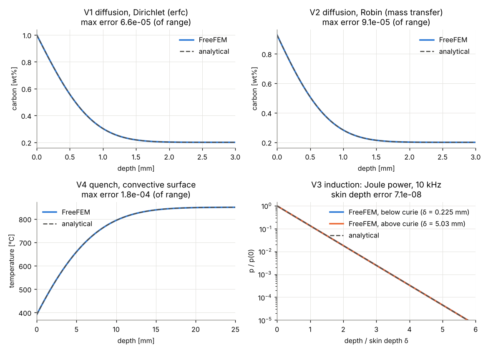
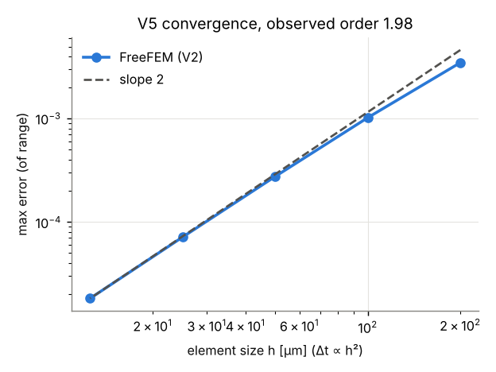
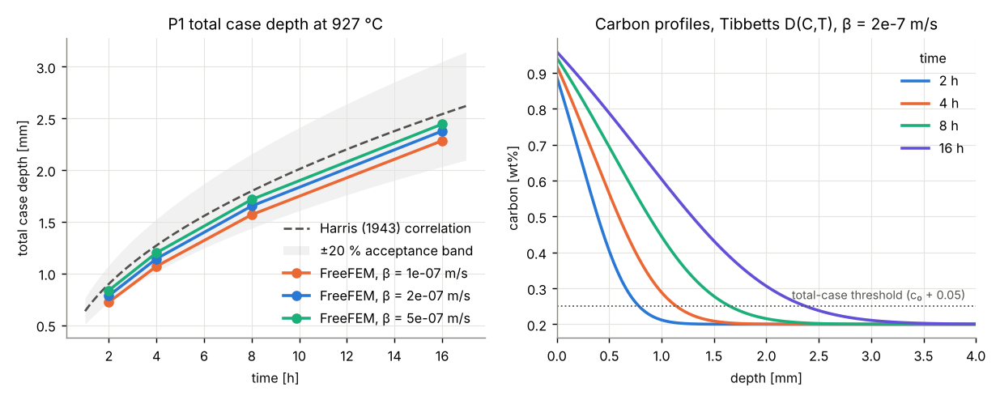
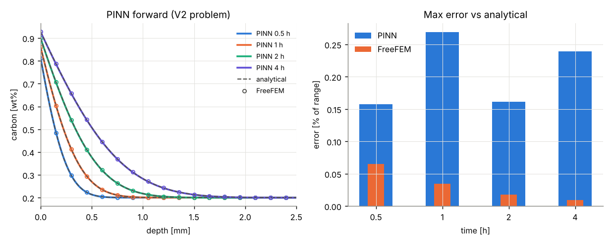
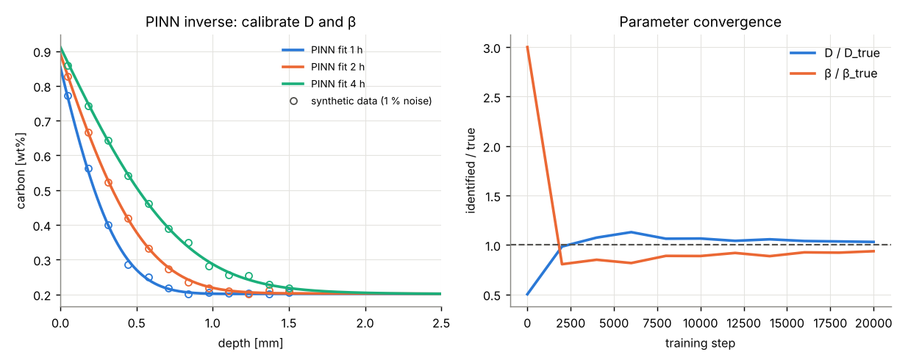

# Verification & validation report

Generated by `scripts/run_all.py`. Numbers below are copied from `summary.json`.

## Verification against analytical solutions

| Case | Error | Tolerance | Result |
|---|---|---|---|
| V1 diffusion, Dirichlet (erfc) | 6.56e-05 | 0.001 | PASS |
| V2 diffusion, Robin (mass transfer) | 9.07e-05 | 0.001 | PASS |
| V3 eddy current (below curie) | 2.08e-06 | 0.001 | PASS |
| V3 eddy current (above curie) | 2.08e-06 | 0.001 | PASS |
| V4 quench, convective surface | 1.83e-04 | 0.001 | PASS |
| V5 convergence (V2, dt ~ h^2) | observed order 1.98 | 1.8 | PASS |

## Validation against published data

### P1: case depth vs the Harris (1943) correlation

Harris' correlation was fitted to measured carburized case depths. Model: Tibbetts (1980)
carbon diffusivity D(C,T), surface mass transfer β (assumed; see sensitivity), 927 °C,
carbon potential 1.0 wt%, core 0.2 wt%. Total case depth taken at c₀ + 0.05 wt%.

| β [m/s] | t [h] | surface C [wt%] | total case [mm] | depth at 0.4 %C [mm] | Harris [mm] | diff |
|---|---|---|---|---|---|---|
| 1e-07 | 2 | 0.797 | 0.722 | 0.433 | 0.899 | -19.6 % |
| 1e-07 | 4 | 0.847 | 1.069 | 0.669 | 1.271 | -15.9 % |
| 1e-07 | 8 | 0.888 | 1.569 | 1.012 | 1.797 | -12.7 % |
| 1e-07 | 16 | 0.918 | 2.284 | 1.505 | 2.542 | -10.1 % |
| 2e-07 | 2 | 0.887 | 0.785 | 0.505 | 0.899 | -12.7 % |
| 2e-07 | 4 | 0.918 | 1.142 | 0.752 | 1.271 | -10.1 % |
| 2e-07 | 8 | 0.941 | 1.653 | 1.105 | 1.797 | -8.0 % |
| 2e-07 | 16 | 0.958 | 2.378 | 1.607 | 2.542 | -6.4 % |
| 5e-07 | 2 | 0.953 | 0.837 | 0.563 | 0.899 | -6.9 % |
| 5e-07 | 4 | 0.966 | 1.200 | 0.815 | 1.271 | -5.6 % |
| 5e-07 | 8 | 0.976 | 1.715 | 1.172 | 1.797 | -4.6 % |
| 5e-07 | 16 | 0.983 | 2.445 | 1.678 | 2.542 | -3.8 % |

Time exponent of case depth (β = 2e-7): 0.533 (ideal diffusion: 0.5). Acceptance: within ±20 % at β = 2e-7 → **PASS**.

### P2: digitized published profiles

No datasets in `data/published/` yet. See `data/published/README.md` for the format and
candidate open-access sources.

## PINN (hybrid layer)

Forward: max error vs analytical 0.27 % of range (tolerance 3 %) → **PASS**. Training 250 s on CPU (20000 steps); inference 1.75 ms for a 301-point profile.

| t [h] | PINN vs analytical | FreeFEM vs analytical |
|---|---|---|
| 0.5 | 0.16 % | 0.065 % |
| 1 | 0.27 % | 0.034 % |
| 2 | 0.16 % | 0.018 % |
| 4 | 0.24 % | 0.009 % |

Inverse (synthetic: FreeFEM + 1 % Gaussian noise, 3 times x 12 depths): starting from D = 7.50e-12, β = 6.00e-07, identified D = 1.546e-11 m²/s (true 1.50e-11, error 3.0 %), β = 1.873e-07 m/s (true 2.00e-07, error 6.4 %). Tolerance 15 % → **PASS**.

